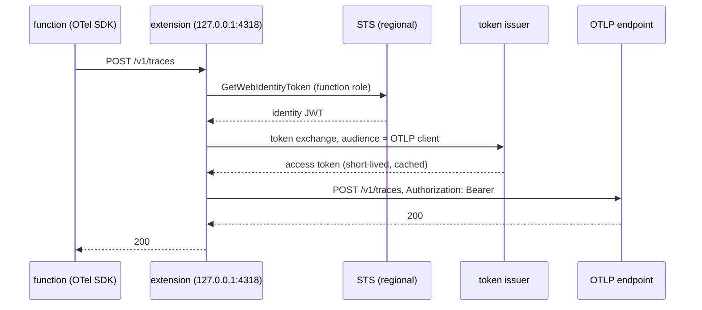

# AWS Lambda — telemetry with the function role's identity

A Lambda function can send its OpenTelemetry data to an OTLP endpoint that
trusts an RFC 8693 token issuer (access-roster is the one this was built
against) **without holding any secret**. The extension is generic: any
function in any language can use it. It is the Go package
`github.com/truvity/observability/lambdaext`, built as `cmd/otlp-lambda`, and
the release carries it as a layer zip,
`otlp-lambda-layer_<version>_linux_<arch>.zip`, which does four things for the
function:

1. asks STS for an identity token for the role the function already runs as
   (`sts:GetWebIdentityToken`, AWS outbound identity federation);
2. trades it at the issuer (RFC 8693 token exchange) for a
   short-lived access token audienced at the OTLP endpoint;
3. runs an OTLP/HTTP proxy on `127.0.0.1:4318` that forwards every export to
   the endpoint with that token as the bearer;
4. subscribes to the Lambda **Telemetry API** and sends the platform's own
   events (timeouts, out-of-memory kills, init errors, the `REPORT` metrics)
   as OTLP logs through the same upstream and token, with no CloudWatch in
   the path ([Platform logs](#platform-logs)).

The function's own OpenTelemetry SDK needs no credential and no auth
configuration. It exports to the loopback address, with any language's
standard OTLP/HTTP exporter:

```
OTEL_EXPORTER_OTLP_ENDPOINT=http://127.0.0.1:4318
OTEL_EXPORTER_OTLP_PROTOCOL=http/protobuf   # or http/json
```

gRPC OTLP is not supported (HTTP protobuf and JSON only).



## Why a proxy, and why on demand

A Lambda execution environment is **frozen between invocations**: no timer
runs while it is frozen, so a token refreshed by a background loop can be
expired when the environment thaws and the function exports. The extension
therefore checks the clock on every export: a token is cached until a third
of its life remains, and a caller that finds it inside that window waits for
a new one (concurrent callers share one refresh). The extension also warms
the token on each `INVOKE`, so the usual export finds a fresh one waiting.

Forwarding is **synchronous**. Answering the exporter early and forwarding
later would let the environment freeze with the export still in memory.

## Platform logs

The function's own OTel SDK cannot report that it was killed: a timeout, an
out-of-memory kill or a failed init ends the process before it can export
anything. Lambda reports those itself, to the Telemetry API, and the
extension forwards them as OTLP **logs** to `<endpoint>/v1/logs` (protobuf,
`Authorization: Bearer`, the same token source as the proxy).

The extension starts a listener, subscribes to the Telemetry API
(`PUT /2022-07-01/telemetry`, schema `2022-12-13`) naming it as the
destination, and Lambda POSTs batches to it. The platform's own buffering
(`maxItems`, `maxBytes`, `timeoutMs`) decides how often; the extension
answers each POST at once and exports in the background, and always exports
what it holds **before** it asks for the next event, because that is the
moment the environment may be frozen.

| Event | Severity | Body (shape) | Attributes |
|---|---|---|---|
| `platform.initStart` | INFO | `INIT_START Runtime Version: <v> Phase: <p>` | `initializationType`, `phase` |
| `platform.initRuntimeDone` | INFO, ERROR if `status` is not `success` or `errorType` is set | `INIT_RUNTIME_DONE Phase: <p> Status: <s>` | `status`, `errorType` |
| `platform.initReport` | as above | `INIT_REPORT Phase: <p> Status: <s> Duration: <ms>` | `status`, `durationMs` |
| `platform.start` | INFO | `START RequestId: <id> Version: <v>` | `requestId` |
| `platform.runtimeDone` | INFO, ERROR on `failure`, `error`, `timeout` | `RUNTIME_DONE RequestId: <id> Status: <s>` | `status`, `errorType`, `durationMs`, `producedBytes` |
| `platform.report` | INFO, ERROR on `error`, `timeout`, or any `errorType` (`Task.Timedout`, `Runtime.OutOfMemory`, ...) | `REPORT RequestId: <id> Duration: ... Billed Duration: ... Memory Size: ... Max Memory Used: ... Init Duration: ...` | `status`, `errorType`, `durationMs`, `billedDurationMs`, `memorySizeMB`, `maxMemoryUsedMB`, `initDurationMs`, `restoreDurationMs` |
| `platform.restoreStart` / `restoreRuntimeDone` / `restoreReport` | as above | `RESTORE_...` | `status`, `errorType`, `durationMs` |
| `platform.logsDropped` | WARN | `LOGS_DROPPED Reason: <r>` | `droppedRecords`, `droppedBytes` |
| `platform.telemetrySubscription` and other `platform.*` | INFO | the event name and status | `status` |
| `function` (default on) | INFO, or the JSON line's `level` | the line, or its `msg`/`message` | the JSON line's other keys; `requestId` for Lambda JSON logs |
| `extension` (opt-in) | INFO | the line | |

Every record has `event.name` (the event type above), `requestId` and
`faas.invocation_id` where the event has one, and the event's own timestamp.
When the event carries X-Ray tracing (`tracing.value`), the record carries
the trace id from `Root=`, the span from `tracing.spanId` (else `Parent=`)
and the sampled flag, so a log lines up with the function's own trace.

The resource of every record is `service.name` (`OTEL_SERVICE_NAME`, else the
function name), `faas.name`, `faas.version`, `faas.instance` (the log
stream), `faas.max_memory`, `cloud.provider=aws`, `cloud.platform=aws_lambda`
and `cloud.region`.

**Function logs are forwarded by default; extension logs are not.** Every line
the function writes to stdout/stderr reaches the log store through the
extension, with no CloudWatch in the path. That is a **duplicate** for a
function that already exports its logs through an OpenTelemetry logs SDK: each
line would arrive once from the SDK and once from the Telemetry API. Such a
function sets `OTLP_LAMBDA_FUNCTION_LOGS=false`. Platform events are never in
the SDK's logs, so they have no duplicate. Lambda still writes the same lines
to CloudWatch Logs unless the function role's logging is denied there; the
extension does not turn that off.

**A function log line that is a JSON object is lifted**, whether the function
logs text (a JSON line printed to stdout) or uses Lambda's JSON log format:

| Key | Becomes |
|---|---|
| `trace_id` (32 hex) and `span_id` (16 hex) | the record's trace id and span id. Not all zero, else ignored. `trace_flags` (2 hex), when present, is the record's flags. |
| `level`, else `severity`, `Level` | the severity: `trace`/`debug`, `info`, `warn`/`warning`, `error`, `fatal`/`critical`/`panic` in any case; slog's offset forms (`ERROR+2`, a minus offset on DEBUG) by the word before the offset; pino's numbers 10 and 20 (debug), 30, 40, 50, 60. Anything else stays an attribute and the severity is INFO. |
| `msg`, else `message`, `Message` | the body (a value that is not a string leaves the whole line as the body) |
| `time`, else `timestamp`, `ts` (RFC 3339) | the record's timestamp, when it is after 1970 and between 7 days before and 5 minutes after the moment the extension received the line. Otherwise the event's time stays and the text is the attribute `log.time`. |
| `requestId` | the attribute `log.attr.requestId`. The `requestId` and `faas.invocation_id` of a function record come from the invocation in flight (`platform.start`), never from the line, and only when the line names no request or that one. |
| any other key | an attribute, **in line order**: strings, integers and floats as such (a number beyond float64 as its digits), booleans as `"true"`/`"false"`, objects and arrays as JSON text, `null` dropped. At most 64 per line; when the cap bites `log.attrs_truncated=true`. A key is cut at 128 bytes, a value at 4 KiB (a cut value ends in `...[truncated]`). A repeated key keeps its last value. |

A key in a namespace the extension owns (`event.name`, `service.`, `cloud.`, `faas.`, `k8s.`, `host.`, `telemetry.`, `otel.`, `log.`) is kept as `log.attr.<key>`, so a line cannot impersonate the platform or the function's resource.

**Size limits.** A line longer than 64 KiB is not parsed: its first 64 KiB is the body and the record has `log.truncated=true`, as has any text line cut to that size. Invalid UTF8 is replaced by U+FFFD (a protobuf string must be valid UTF8, or the whole export would be refused). The export queue is bounded by records and by bytes (`OTLP_LAMBDA_TELEMETRY_BUFFER_QUEUE_BYTES`, 4 MiB by default, an estimate of the records' size): beyond either, the oldest are dropped and the next export starts with the WARN record that counts them.

With no `msg`/`message` the whole line is the body. A line that is not a JSON object is forwarded as its text. **X-Ray is the fallback for the trace
context:** a function log line with no valid `trace_id` takes the X-Ray trace of
the invocation the platform last announced (`platform.start`), unless the line
names a different `requestId`; after `platform.runtimeDone` a line takes none.
A `trace_id` in the line always wins.

**What a line is trusted for.** The function writes its own log lines, so the extension takes `trace_id`, `span_id`, the severity and (inside the window above) the timestamp as the line says: a function can link its logs to an unrelated trace, or label an error as INFO. That is the same authority the function already has over its own SDK's telemetry. Nothing a line says can set the resource, `event.name` or the invocation id.

The queue is bounded in memory (`OTLP_LAMBDA_TELEMETRY_BUFFER_QUEUE_ITEMS`,
5000 records, a few MB at most). If exports cannot keep up, the **oldest**
records are dropped and the next export starts with a WARN record saying how
many were. The export is fail-open like the rest: with no token or a failing
upstream the batch is dropped, one log line is written per failure window and
one when it recovers, and the invocation is never held up. A `401` drops the
token and retries once. On `SHUTDOWN` the extension stops the listener and
exports what is left within the shutdown deadline.

Outside Lambda, and in the Runtime Interface Emulator, the Telemetry API is
absent (the emulator answers the subscription `202 Telemetry.NotSupported`):
the extension logs one line and runs without it.

## What the extension does when something is wrong

It is **fail-open**: telemetry never blocks, slows or crashes an invocation.

- No token (STS refused, the issuer is down or refuses the role): the proxy
  answers `503` with `Retry-After`, which OTLP exporters treat as retryable,
  and the extension logs **one line per failure window** (and one when it
  recovers). After a failure it does not call STS again for 5 seconds, so an
  exporter's retries are not a request storm. A token that is still valid is
  used even if its replacement failed.
- Missing or invalid configuration, or the port is taken: one log line, and
  the extension keeps answering the platform (an extension that exits is
  reported by Lambda as a crash of the invocation). Exports then find nothing
  listening.
- The upstream answers `401`: the cached token is dropped and the next export
  obtains a new one. Other upstream statuses are relayed unchanged.
- `SHUTDOWN`: the proxy stops accepting, lets in-flight forwards finish within
  the shutdown deadline, and exits.

Tokens are held in memory only (plus the optional file below) and are never
logged.

## Configuration

All settings are environment variables on the function, named `OTLP_LAMBDA_*`.
Two earlier spellings are still read, so a function that sets only the old
names works unchanged: `SLUIS_*` (the same name with that prefix, except
`OTLP_LAMBDA_ENDPOINT`, which was `SLUIS_OTLP_ENDPOINT`) and, before it,
`ACCESS_ROSTER_*`. The newest name wins; a blank value falls through to the next.
For each old name it uses, the extension logs one deprecation line at start
that names the variable and never its value. Set the `OTLP_LAMBDA_*` names and
drop the old ones. Prefer them in a deploy, too, because the `SLUIS_*` fallback is shared with the sluis function's own environment: a `SLUIS_LISTEN` or `SLUIS_*_LOGS` that sluis itself later reads would also reconfigure the extension in that function. A layer version older than the generic names reads only the
old ones, so set both while a function may still run one.

| Variable | Default | Meaning |
|---|---|---|
| `OTLP_LAMBDA_ISSUER` | required | The issuer's base URL. |
| `OTLP_LAMBDA_AUDIENCE` | required | The audience asked of STS for the identity token. What the issuer's AWS verifier expects; the role policy pins it (below). |
| `OTLP_LAMBDA_ENDPOINT` | required | The OTLP/HTTP base URL, `https`. The extension appends `/v1/traces`, `/v1/metrics`, `/v1/logs`. Plain `http` is accepted only for a loopback host. |
| `OTLP_LAMBDA_OTLP_AUDIENCE` | `otlp` | The exchange's audience and client id: the roster client that the OTLP endpoint accepts. |
| `OTLP_LAMBDA_LISTEN` | `127.0.0.1:4318` | The proxy's address. |
| `OTLP_LAMBDA_STS_DURATION_SECONDS` | `300` | Lifetime asked of the STS token (60 to 3600). It is used once, for the exchange. |
| `OTLP_LAMBDA_STS_ALGORITHM` | `ES384` | Signing algorithm asked of STS (`ES384` or `RS256`). |
| `OTLP_LAMBDA_PLATFORM_LOGS` | `true` | Subscribe to Telemetry API `platform` events and forward them as OTLP logs. |
| `OTLP_LAMBDA_FUNCTION_LOGS` | `true` | Forward `function` logs (the function's stdout/stderr), lifting JSON lines. Set `false` for a function that exports its logs through its own OTel logs SDK, or each line arrives twice; see [Platform logs](#platform-logs). |
| `OTLP_LAMBDA_EXTENSION_LOGS` | `false` | Also forward `extension` logs (other extensions' output). |
| `OTLP_LAMBDA_TELEMETRY_LISTEN` | `sandbox.localdomain:4243` | The Telemetry API destination. Bound on all interfaces of the sandbox at that port when the host is `sandbox.localdomain`. |
| `OTLP_LAMBDA_TELEMETRY_BUFFER_MAX_ITEMS` | `1000` | The platform's batch size in events (1000 to 10000). |
| `OTLP_LAMBDA_TELEMETRY_BUFFER_MAX_BYTES` | `262144` | The platform's batch size in bytes (262144 to 1048576). |
| `OTLP_LAMBDA_TELEMETRY_BUFFER_TIMEOUT_MS` | `1000` | The platform's longest wait before delivering a batch (25 to 30000). |
| `OTLP_LAMBDA_TELEMETRY_BUFFER_QUEUE_ITEMS` | `5000` | Records held in the extension waiting for an export (100 to 1000000); beyond it the oldest are dropped and counted. |
| `OTLP_LAMBDA_TELEMETRY_BUFFER_QUEUE_BYTES` | `4194304` | The same queue bounded by the records' estimated size (262144 to 1073741824); beyond it the oldest are dropped and counted. |
| `OTLP_LAMBDA_TOKEN_FILE` | unset | If set, each access token is also written here (mode 0600, replaced atomically; the directory is created 0700). For a function that runs its own collector with a bearer-token-from-file extension. Off by default. Use a path under `/tmp`. |

STS needs a **regional** endpoint (the global one does not support the
call): the SDK picks it from `AWS_REGION`, which Lambda sets. The extension
needs egress to the regional STS endpoint, the issuer and the OTLP endpoint;
a VPC function without a NAT needs an STS interface endpoint.

## IAM and account setup

1. **The account must have outbound identity federation enabled** (IAM
   account settings, or `aws iam enable-outbound-web-identity-federation`).
   Without it STS answers `OutboundWebIdentityFederationDisabled`, which the
   extension logs.
2. **The function role** needs `sts:GetWebIdentityToken`, and the policy
   should pin the audience (and, optionally, the lifetime and algorithm):

```json
{
  "Effect": "Allow",
  "Action": "sts:GetWebIdentityToken",
  "Resource": "*",
  "Condition": {
    "ForAllValues:StringEquals": {
      "sts:IdentityTokenAudience": "https://access.example"
    },
    "StringEquals": { "sts:SigningAlgorithm": "ES384" },
    "NumericLessThanEquals": { "sts:DurationSeconds": "300" }
  }
}
```

`sts:IdentityTokenAudience` is a multi-valued key (the API takes a list of
audiences), so it needs the `ForAllValues:StringEquals` operator. A plain
`StringEquals` evaluates to an implicit deny when the request carries the
audience as a list, and STS answers `AccessDenied ... no identity-based policy
allows the sts:GetWebIdentityToken action`. `ForAllValues` also passes on an
empty set, which is safe here only because `Audience` is a required parameter
of [GetWebIdentityToken](https://docs.aws.amazon.com/STS/latest/APIReference/API_GetWebIdentityToken.html).
`sts:SigningAlgorithm` is single-valued and keeps `StringEquals`.

3. **The roster** must admit the role: the issuer-side AWS verifier recognises
   the account, and a group matcher selects the role, for example by a role
   name pattern such as `billing-*` in that account. A role in no group is
   refused at the exchange, which shows up as a `503` plus the issuer's
   sentence in the extension's log line.

## Attaching the layer

Each release carries one zip per architecture:

| Lambda architecture | Release asset |
|---|---|
| `x86_64` | `otlp-lambda-layer_<version>_linux_amd64.zip` |
| `arm64` | `otlp-lambda-layer_<version>_linux_arm64.zip` |

The zip root is the layer root: it holds one file,
`extensions/otlp-lambda` (mode 0755). Publish it as a layer version in
your own account and region, with the matching `--compatible-architectures`,
and add it to the function:

```
aws lambda publish-layer-version --layer-name otlp-lambda \
  --zip-file fileb://otlp-lambda-layer_<version>_linux_arm64.zip \
  --compatible-architectures arm64
```

Each release also carries `checksums.txt`; verify the zip against it before
publishing. The release does not publish a layer version for you. The binary is a static
Go executable with no runtime dependency, so it works with every runtime,
including container-image functions (copy it to `/opt/extensions/`).

## Size and cold start

| | amd64 | arm64 |
|---|---|---|
| binary (stripped, `-trimpath`) | 10.06 MB | 9.31 MB |
| zip | 4.01 MB | 3.60 MB |

In the Lambda Runtime Interface Emulator the extension registers and init
completes in about 12 ms (the first token is fetched in the background,
after registering, so it does not delay init). Lambda bills extension time
like function time; the proxy is idle between exports.

## Tests

`lambdaext` has unit tests (token cache, expiry after a freeze,
single flight, failure backoff, STS and exchange against fakes, proxy
headers/body/encoding, 503 and refusals) and end-to-end tests that run the
real binary against a fake Extensions API, STS, issuer and OTLP upstream. One
more test runs it in the real Lambda base image with `aws-lambda-rie`; it is
opt-in (`OTLP_LAMBDA_RIE=1`, needs docker and port 8080; CI does not run it).

The Telemetry API is covered by tests against a fake Telemetry API
(subscription, batches POSTed to the extension's listener, records arriving at
the fake upstream with the bearer token, flush on `SHUTDOWN`) and by unit
tests of the event mapping with the AWS reference payloads (including a
timeout and an out-of-memory report). The emulator has no Telemetry API, so
the opt-in emulator test only proves the extension tolerates that.

Not covered by the layer: gRPC OTLP. The OTLP logs are written by a small
hand-rolled protobuf encoder rather than the generated packages, which would
add about 6.7 MB to the binary; a test decodes its output with the generated
schema.
