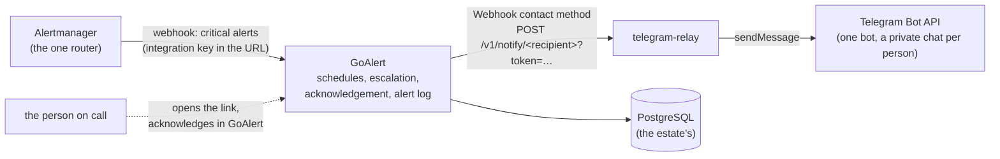

# On-call: GoAlert and telegram-relay

`charts/oncall` and `cmd/telegram-relay`: who is paged, in what order, and
the record that they acknowledged. Alertmanager stays the one router
([doctrine.md](doctrine.md)); it decides which alerts page and hands those
to GoAlert. It never writes to Telegram itself.



## Why these pieces

- **GoAlert** is the on-call scheduler: rotations, schedules, escalation
  policies ("person A, then person B after 10 minutes"), acknowledgement
  that stops the repeats, and an alert log per alert that is the incident
  record. It is the upstream image, unmodified; this chart only runs it.
- **GoAlert has no Telegram contact method**, but every user can add a
  *Webhook* one. `telegram-relay` is that webhook: it turns GoAlert's JSON
  document into a Telegram message from one bot to the person's own
  chat with it.
- **Alertmanager feeds GoAlert** through GoAlert's Alertmanager
  integration. A route decides what pages; GoAlert decides who.

## What the chart renders

| Object | Notes |
|---|---|
| `<release>-goalert` ServiceAccount, Service, Deployment | the upstream image; one ServiceAccount of its own, no API token; Pod Security `restricted`; `startupProbe`/`readinessProbe`/`livenessProbe` on `/health`; Prometheus metrics on `service.metricsPort` (not in the Service) |
| `<release>-telegram-relay` ServiceAccount, Service, Deployment | `relay.enabled`; the same posture; `/readyz` is ready only while the Secret's three files read and parse |
| NetworkPolicies | `networkPolicy.enabled`: a default-deny for both workloads, then exactly the allows below |
| HTTPRoute | `httpRoute.enabled`: GoAlert's UI, API and integrations at `goalert.publicURL` |
| PodMonitors, VMRule | `selfMonitor`; `rules.deliveryFailing` |

The chart renders **no database and no secret value**. PostgreSQL is a
cluster the estate runs; every credential is the name of a Secret the
estate delivers (an external-secrets operator, say).

### GoAlert's configuration

GoAlert reads its process flags from the environment and keeps everything
else (OIDC sign-in, the Webhook contact method, message bundling) in its
database, edited on the admin "Config" page.

- `GOALERT_DB_URL` is `postgres://<user>@<host>:<port>/<name>?sslmode=…`
  with no password; the password is `PGPASSWORD` from
  `goalert.database.passwordSecret`, which the PostgreSQL driver reads for
  any URL that carries none. With `goalert.database.ca`, the CA is mounted
  at `/etc/oncall/db-ca/<key>` and passed as `sslrootcert`.
- `GOALERT_DATA_ENCRYPTION_KEY` from `goalert.dataEncryptionKeySecret`.
  GoAlert encrypts its signing keys and stored secrets with it: keep it
  with the database's backups, or a restore is unreadable.
- `GOALERT_PUBLIC_URL` is `goalert.publicURL`: every link in a page, the
  OIDC callback (`<publicURL>/api/v2/identity/providers/oidc/callback`) and
  the integration URLs GoAlert shows.
- **Declarative configuration** (`goalert.config.existingSecret`, off by
  default): a Secret key holding the whole configuration as JSON, the
  shape `goalert get-config` prints. Set, every pod start runs `goalert
  migrate` and `goalert set-config` as init containers, so git overwrites
  the admin page on every rollout. A Secret, because the configuration
  carries the OIDC client secret. A minimal one for OIDC sign-in and the
  relay:

  ```json
  {
    "General": {"ApplicationName": "On call"},
    "Auth": {"DisableBasic": true},
    "OIDC": {
      "Enable": true,
      "NewUsers": true,
      "OverrideName": "Sign in",
      "IssuerURL": "https://issuer.example",
      "ClientID": "oncall",
      "ClientSecret": "<from the issuer>"
    },
    "Webhook": {
      "Enable": true,
      "AllowedURLs": ["http://oncall-telegram-relay.oncall.svc:8080/v1/notify/"]
    }
  }
  ```

  GoAlert's OIDC has no group filter: restrict who may sign in at the
  issuer (a client only the on-call group may use). A user OIDC creates
  is not an admin; promote the first one with `goalert add-user` or in the
  admin UI from a basic-auth admin made before `DisableBasic`.

## telegram-relay

`POST /v1/notify/{recipient}` on `relay.port`. `/metrics`, `/healthz` and
`/readyz` on `relay.metricsPort`, which is not in the Service.

| Step | |
|---|---|
| authenticate | the shared secret as `?token=`, as the Basic-auth password written into the URL (`http://relay:<secret>@host/...`), or as a bearer token, compared in constant time. GoAlert can set no header, so a contact method's URL carries it. Checked before anything else, so an unauthenticated caller learns nothing about recipients. |
| decode | one of GoAlert's documents: `Alert`, `AlertStatus`, `AlertBundle`, `AlertStatusBundle`, `Verification`, `Test`, `ScheduleOnCallUsers`. Anything else is refused (400) and counted. |
| resolve | `{recipient}` must be a key of the recipients file; the chat id comes from there, never from the request, so a GoAlert user cannot make the bot write to a chat nobody configured. |
| send | Telegram `sendMessage`, HTML, every field escaped, links only for absolute http(s) URLs, details cut to keep under Telegram's 4096 characters. One attempt within `relay.sendTimeout` (default 2.5s): GoAlert gives a webhook 3s in total. |

The Secret (`relay.secret`) has three keys, mounted as files and re-read on
every request, so a rotated token or a new person needs no restart:

| Key (default name) | Content |
|---|---|
| `bot-token` | the bot's token from @BotFather |
| `shared-secret` | at least 16 bytes; the `?token=` every contact-method URL carries |
| `recipients.yaml` | `name: chat_id` lines; names are `[a-z0-9][a-z0-9._-]*`, chat ids numeric (a person's private chat with the bot is positive) |

**GoAlert does not read the webhook's answer**: it records every message it
handed over as sent. A page Telegram refused is visible only in the relay's
own counter, `telegram_relay_notifications_total{type,result}` (`result`:
`delivered`, `unauthorized`, `bad_request`, `unknown_recipient`,
`telegram_error`, `config_error`), and in its log. `TelegramRelayDeliveryFailing`
(`rules.deliveryFailing`, default severity `warning`) fires on any
`telegram_error`, `unknown_recipient` or `config_error` in the window; route
it to a channel that does not depend on the relay. A 403 from Telegram means
the person blocked the bot or never pressed Start: a bot can only write to
someone who wrote to it first.

### Onboarding a person

1. They open a chat with the bot and press **Start**; their chat id is in
   the bot's `getUpdates` (or ask any id bot).
2. Add `<name>: <chat id>` to the recipients key of the relay's Secret.
3. In GoAlert, they add a contact method of type **Webhook** with the URL
   `http://<release>-telegram-relay.<namespace>.svc:8080/v1/notify/<name>?token=<shared secret>`,
   verify it with the code the relay delivers, and add it to their
   notification rules.

## NetworkPolicies

With `networkPolicy.enabled` (the default), a `<release>-default-deny`
policy selects every pod of the release in both directions, and then:

| Pod | Ingress | Egress |
|---|---|---|
| GoAlert | `goalertFrom` on `service.port` (the gateway, and Alertmanager); `metricsFrom` on `service.metricsPort` | `databasePeers` on `goalert.database.port`; the relay on `relay.port`; DNS; HTTPS anywhere with `goalertHTTPS` (the OIDC issuer) |
| relay | GoAlert's pods on `relay.port`; `metricsFrom` on `relay.metricsPort` | DNS; HTTPS anywhere (the Bot API) |

`metricsFrom` empty allows the metrics ports from any source; `dns` empty
allows port 53 to any destination. The database's own pods are not
selected: they are another chart's.

## Feeding it from Alertmanager

In GoAlert, create a service and an *Alertmanager* integration key; its URL
is `<publicURL>/api/v2/prometheusalertmanager/incoming?token=<key>`. Inside
the cluster, use the Service instead of the public host. In
`observability-stack`/`observability-alerting`, put that URL in a Secret
and add a webhook receiver and an `also` bridge (see
[notifications.md](notifications.md)):

```yaml
notifications:
  webhook:
    - name: goalert
      urlSecret: {name: example-goalert-alertmanager, key: url}
  also:
    - receiver: goalert
      match: {severity: critical}
```

Slack keeps everything; GoAlert pages for what the bridge matches.
`alertmanager_notifications_failed_total{integration="webhook"}` counts a
GoAlert that cannot be reached.

## Refusals

| Shape | Why |
|---|---|
| `goalert.publicURL` empty, relative, or with a trailing slash | every link and the sign-in callback are built from it |
| `goalert.dataEncryptionKeySecret.name` empty | GoAlert would store its keys unencrypted |
| `goalert.database.host` or `passwordSecret.name` empty | a GoAlert with no database |
| `goalert.database.ca` with both `configMap` and `secret`, or with an `sslMode` that never reads it | one CA, and only where it is used |
| `relay.secret.name` empty while the relay is enabled | a relay with no bot |
| `relay.port` equal to `relay.metricsPort`; `service.port` equal to `service.metricsPort` | `/metrics` reachable through the served port |
| `httpRoute.enabled` with no `parentRefs`, or `hostnames` without the host of `publicURL` | a route attached to nothing, or not serving the URL every page links to |
| `networkPolicy.enabled` with an empty `goalertFrom` or `databasePeers` | under the default-deny, a GoAlert nobody reaches, or that reaches no database |
| an unknown key, or `sslMode` outside `disable`/`require`/`verify-ca`/`verify-full` (schema) | a typo in a paging path is a page that never arrives |

Each has a fixture under `tests/invalid/oncall/`.

## Proven by

- `cmd/telegram-relay`'s tests run the real handler, files and Telegram
  client against a fake Bot API: delivery to the configured chat, the
  three ways to carry the secret, refusals before any lookup, a recipient
  added without a restart, unsupported documents, Telegram refusals and
  timeouts counted with neither the token nor the secret in the log.
- `tests/oncall_test.go` over the goldens: Pod Security `restricted`, one
  ServiceAccount per workload with no token, no secret value anywhere in
  the render, the default-deny selecting both workloads, the relay
  admitting only GoAlert, no metrics port in a Service.
