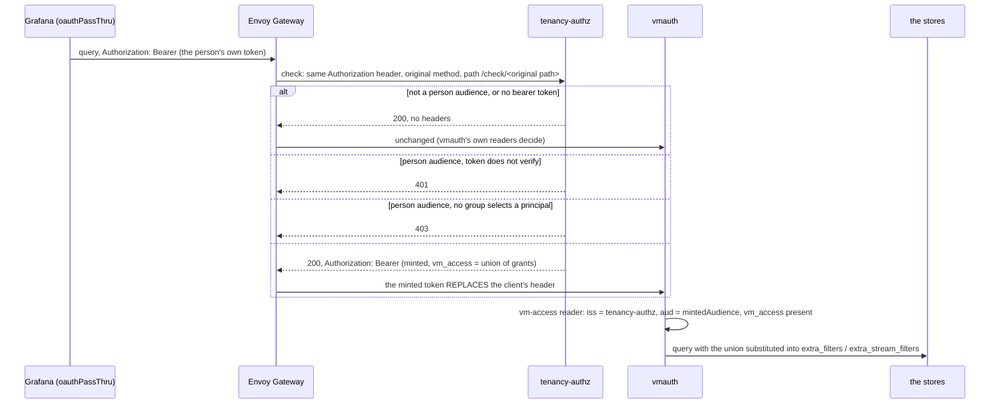

# tenancy-authz: a person's groups, unioned into the filters vmauth enforces

`tenancy.authz` (opt-in, in `charts/observability-stack`) renders
`cmd/tenancy-authz`, an Envoy **external authorisation** service that sits in
front of vmauth on the route people read through. It exists for one
reason: vmauth cannot turn a *list of groups* into a *union of filters*.

- vmauth selects **one** user per token, by `match_claims`. A person who
  holds two groups reads whatever the first matching principal allows and
  never both.
- vmauth can template filters only from a `vm_access` claim in the token
  (`{{.MetricsExtraFilters}}`, `{{.LogsExtraStreamFilters}}`). An identity
  provider's tokens carry **groups**; putting store query syntax into the
  sign-in service was tried and rejected.

So the grant is computed here, from the same `tenancy.principals` the
VMUsers render from, and handed to vmauth in a token vmauth trusts for that
purpose and no other.

## The flow



For a person's token the service:

1. parses the bearer token **without trusting it** and reads `aud`. If it is
   none of `personAudiences` (a workload's token, a static reader's token, no
   token at all), it answers 200 and changes nothing;
2. otherwise verifies it against `upstreamIssuer` — OIDC discovery, a cached
   key set, signature, `iss`, `aud`, `exp` (with `leeway`, 10 s by default).
   Only asymmetric algorithms are accepted. A token with no `exp` or no `sub`
   is refused. Invalid: **401**;
3. reads the `groups` claim (the claim name is `tenancy.claimName`) and finds
   **every** principal that holds one of its groups. None: **403**;
4. unions their grants per cluster (a grant of every namespace on a cluster
   swallows the rest of that cluster's), and renders the claim with
   `pkg/tenancy`'s own `RenderClaim`: one metrics selector per cluster, and
   **one** joined `_stream:{… or …}` string for logs — the log store ANDs
   several filters, so two entries would narrow a person to the intersection;
5. mints an ES256 token: `iss` its own issuer, `aud` `mintedAudience`, `sub`
   the upstream `sub`, `exp` the earlier of the upstream `exp` and now +
   `tokenTTL`, `vm_access` the claim above, and **no `groups`**;
6. answers 200 with `Authorization: Bearer <minted>`.

The `SecurityPolicy` lists `authorization` in `headersToBackend`. Envoy
Gateway's API says coexisting headers are overridden, and that is Envoy's
`allowed_upstream_headers` semantics: the minted header **replaces** the
client's, it is not added beside it. `failOpen: false` makes an unreachable
or failing service a refused request.

The check request's path is the policy's `path` (`/check`) with the original
request path appended, and carries the original method. The service answers
every method and every path under `/check`.

## Traces

The trace store cannot be filtered (`TracesRead` in `pkg/tenancy/route.go`:
VictoriaTraces' Jaeger and Tempo select APIs take no filter argument), and the
vm-access reader serves traces to every minted token, so a person narrower
than the whole store would read every tenant's spans. The service therefore
decides per request. When the original path (after `/check`) is a trace path
(the `TracesRead` paths, matched with the same anchored regular expressions)
and the person does not hold `allNamespaces` on **every** cluster in
`traceClusters`, it answers **403** and counts `forbidden_traces`. Grants are
unioned first, so a whole-cluster group plus a namespace group still has
whole-store reach if the whole-cluster groups cover every cluster; namespace
grants never add up to a cluster. Everyone else behaves as before, and a
workload's token (another audience) passes through untouched. `traceClusters`
is the clusters the trace store serves; the chart defaults it to the union of
clusters named by any person principal's grants and
`tenancy.authz.traceClusters` overrides it. An empty list refuses traces to
every person. A person calling vmauth directly with their own token is not
covered by this (see "Calling vmauth directly").

## The trust model

| Who | trusts | for | how |
|---|---|---|---|
| tenancy-authz | the identity provider (`upstreamIssuer`) | who the caller is and which groups they hold | discovery, key set, signature, `iss`, `aud`, `exp` |
| vmauth, the **vm-access reader** | tenancy-authz **only** | what the caller may read | `jwt.oidc.issuer` is the service's address, and `match_claims` pins `iss`, `aud` (`mintedAudience`) and the two `vm_access.*` lists |
| vmauth, every other user | the identity provider | exactly what they did before | unchanged |

vmauth stays the enforcement point: the service decides *what* a person's
filters are; only vmauth applies them, by substituting them into the route
it forwards on, and it drops a client-supplied `extra_filters` /
`extra_stream_filters` that clashes, by name, with the route's own.

**Why every metrics route pins two spellings.** The clash is by name, and
VictoriaMetrics also reads the array spelling `extra_filters[]` and ORs it
with `extra_filters`. A route that set only `extra_filters` therefore let a
caller send `extra_filters[]={k8s_cluster_name=~".+"}` and widen its own
result, through vmauth directly and through the gateway alike. Every
filtered metrics route (the group principals, the `vm_access` reader, the
metrics readers) now sets both spellings to the same placeholder, in
`pkg/tenancy` and the chart; `hack/tenancy-authz-proof.sh` asserts that the
array spelling returns only the granted series. The log store reads no array
spelling and ANDs every filter it reads, so its route pins one name.

How vmauth learns the service's key: **OIDC discovery served by the service
itself** at `http://<service>.<namespace>.svc:8080`. vmauth accepts an
`http://` issuer, fetches `/.well-known/openid-configuration` and the key set
at start and every five minutes (with jitter), retrying every ten seconds
until the first success, and requires the document's `issuer` to equal the
configured string exactly — which is why the issuer has no path and no
trailing slash. It does **not** refetch on an unknown `kid`; see rotation.

**Calling vmauth directly gains nothing.** The person's own token carries no
`vm_access` and an `iss` that is not the service's, so it never matches the
vm-access reader; it matches the group-selected principal's own VMUser, as it
always did, which is one principal's reach, never more than the union. A
`vm_access` claim a client puts into a token of its own is ignored: the
service builds the claim from groups alone, and the reader accepts the claim
only from a token signed with the service's key. The one secret that matters
is that key: whoever can read the signing Secret can mint any grant, so read
access to that Secret is the control. The chart grants nothing: the pod
mounts it, and no Role exists.

A principal belongs to the people's path when its audience (its own
`audience`, else `tenancy.audience`) is one of `personAudiences`. A workload's
principal on its own audience is not in the service's configuration at all,
so a person who happens to hold that group does not inherit it. The chart
refuses a person's principal that sets `routes`, `metricsQueryOnly` or
`vmalertAPI`: the service mints one claim per person and the reader gives
every claim the same routes, so the narrowing would be dropped silently.

## Enabling it

```yaml
tenancy:
  issuerUrl: https://idp.example          # the identity provider
  audience: grafana                       # the person audience
  vmAccessReader:
    enabled: true                         # required: the reader the service feeds
  authz:
    enabled: true
    securityPolicy:
      targetRefs:                         # the routes people read through
        - {kind: HTTPRoute, name: observability-read}
    networkPolicy:
      gatewayFrom:                        # the Envoy proxy pods
        - namespaceSelector: {matchLabels: {kubernetes.io/metadata.name: envoy-gateway-system}}
  principals: [...]                       # as before
```

- **Apply order.** The `SecurityPolicy` fails closed, so applied before the
  Deployment is Ready (and the `ExternalSecret` has made the key Secret) it
  refuses every read through the route. It carries
  `argocd.argoproj.io/sync-wave: "1"` by default
  (`securityPolicy.annotations`), so Argo CD applies it after the rest of the
  component is healthy; the other objects of the component sit in wave 0.
  Helm has no ordering: install with `securityPolicy.enabled: false`, wait for
  the Deployment, then enable it. `/readyz` answers 200 only with the signing
  key loaded and the upstream key set fetched.
- The HTTPRoute is rendered outside this chart, so the chart cannot guess
  it: name it in `securityPolicy.targetRefs`, or set `securityPolicy.enabled:
  false` and render the policy yourself against the Service this chart
  renders (`extAuth.http` to port 8080, `path: /check`, `headersToBackend`
  and `headersToExtAuth` `authorization`, `failOpen: false`).
- `observability-crds` has an opt-in `sets.envoyGateway` that vendors the
  `SecurityPolicy` CRD, which is how this repository's schema check walks the
  policy it renders. Turn it on only where your Envoy Gateway release does
  not install the CRD.
- The signing key is ES256 and the service only **reads** it, from a mounted
  Secret (the file `privateKey`); it makes no key and holds no credential to
  the cluster API (no Role, no ServiceAccount token). By default
  (`signingKey.source: eso`) External Secrets Operator generates it: the chart
  renders an `SSHKey` generator (`keyType: ecdsa`, `keySize: 256`) and an
  `ExternalSecret` with `refreshPolicy: CreatedOnce` that creates the Secret
  once and never touches it again. With `source: existingSecret` the Secret is
  yours. The file may be OpenSSH (what the generator writes), PKCS#8 or SEC1
  PEM, on P-256.
- `observability-crds` has an opt-in `sets.externalSecrets` for the two
  CRDs, for the same reason as `sets.envoyGateway`.
- The `kid` is the RFC 7638 thumbprint of the public key, so every replica
  names the same key the same way.

## The cache

A dashboard fires dozens of queries with one token. Minted tokens are cached
per **(`sub`, sorted groups, the upstream token's `exp`)** and served until a
margin (a quarter of the token's life, at most 30 s) before they expire. One
dashboard costs one signature.

Consequences, stated plainly: a change of groups is honoured when the
identity provider issues a **new** token (a new `exp`), never from a stale
entry, and then within one `tokenTTL` at the latest; removing a person from a
group does not revoke tokens already minted, which live at most `tokenTTL`
(5 minutes by default) and never longer than the person's own.

## Failure modes

| What fails | What people see | What workloads see |
|---|---|---|
| tenancy-authz down or unready | **no data**: Envoy refuses the request (`failOpen: false`; 403 by default, 5xx if the policy sets `statusOnError`) — never the person's own token forwarded | traffic that goes through the **same route** is refused too (the policy covers the whole route, and a pass-through is still an answer from the service); traffic that calls vmauth **directly** is unaffected |
| the identity provider unreachable | tokens whose `kid` is cached keep verifying; a pod that has never fetched the key set is not ready, so it takes no traffic | unaffected |
| the identity provider rotates its key | the first token with an unknown `kid` triggers one refetch (at most one per 10 s, so random `kid`s cannot hammer the issuer); the timer refetches every 5 minutes | unaffected |
| vmauth cannot reach the service's discovery | person requests get 401 (vmauth: "verifier not initialised") until its next retry; vmauth retries every 10 s | unaffected |
| the signing Secret does not exist yet (the operator has not made it) | the pods wait, unstarted, for the Secret to mount; nothing is served | as above |
| the signing Secret becomes unreadable while running | the service keeps the keys it holds and logs a warning | unaffected |
| a configuration the library refuses | the pod does not start (the whole file is validated first) | as above |
| a person's groups select nothing | 403 | not applicable |
| a person without reach to the whole store asks for traces | 403 on the trace endpoints only (`forbidden_traces`) | not applicable |

**Key rotation:** delete the Secret. External Secrets recreates it with a new
key (`CreatedOnce` creates a target that is missing), the kubelet refreshes
the mount, and each replica notices within a few minutes. No restart. The
service is built so that no token fails on the way:

1. the new key is **published** in the key set at once, beside the old one;
2. it only starts **signing** seven minutes later. vmauth refetches the key
   set on its own five-minute timer and never on an unknown `kid`, so
   signing with a key it has not seen would fail; seven minutes is longer
   than that timer plus a mounted Secret's propagation;
3. the old key stays published until the tokens it signed have expired
   (`tokenTTL` plus ten minutes).

With `source: existingSecret`, replace the Secret's content instead. A pod
that starts in the middle of a rotation sees only the new key and signs with
it at once; for the few minutes until vmauth refetches, tokens from that pod
fail verification. Roll pods after the switch, not during it.

## Observability

`/metrics` is on its own port (9090), scraped by the chart's `ServiceMonitor`:

- `tenancy_authz_checks_total{outcome}` — `pass_through`, `minted`,
  `unauthenticated`, `forbidden`, `forbidden_traces`, `error`;
- `tenancy_authz_check_duration_seconds`;
- `tenancy_authz_mint_cache_hits_total`;
- `tenancy_authz_upstream_refreshes_total{result}`;
- `tenancy_authz_ready`.

Logs carry the subject and the outcome and never a token. A sustained
`error` rate or a `ready` of 0 is people without data.

## The proof

`hack/tenancy-authz-proof.sh` stands up kind with Envoy Gateway, VictoriaMetrics,
VictoriaLogs, vmauth configured from the rendered chart, the service built
locally from the chart's own rendered objects, and a fake identity provider,
and checks: the OR across two groups (metrics and logs), 403 for no group,
401 for a forged token, pass-through for another audience, a direct call
matching nothing it should not, a client-supplied filter not widening the
result, one operator-generated signing key across replicas, a rotation by deleting
the Secret (the new key published beside the old, no restart), traces
refused to namespace-only people and to a whole-cluster person who misses a
cluster, and served to a person with every namespace on every cluster (the
trace store is a stub file server, since the decision is in front of it), and
the route failing closed with the service down. It is a run-by-hand proof, like the other `hack/*-proof.sh`.
